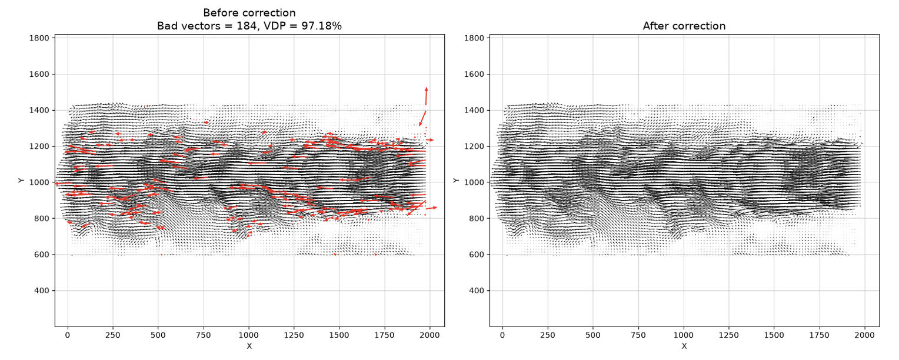
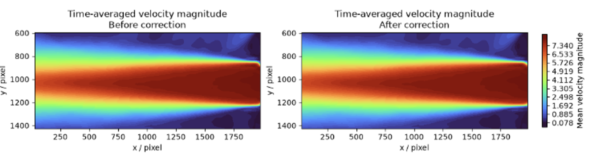
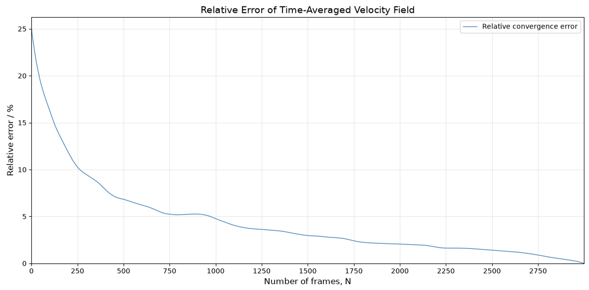
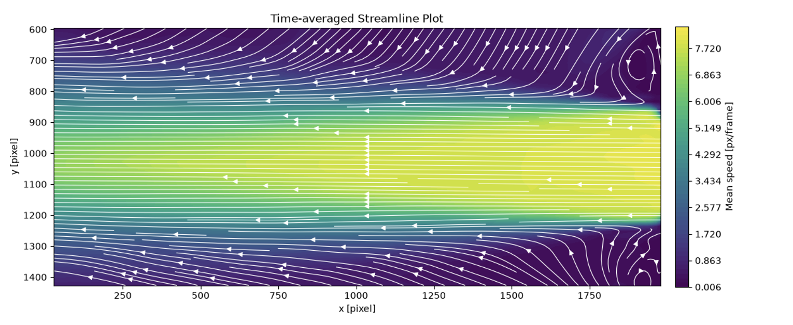
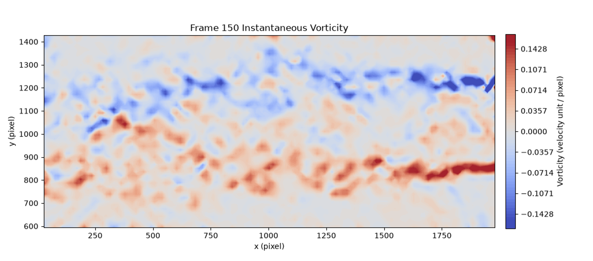
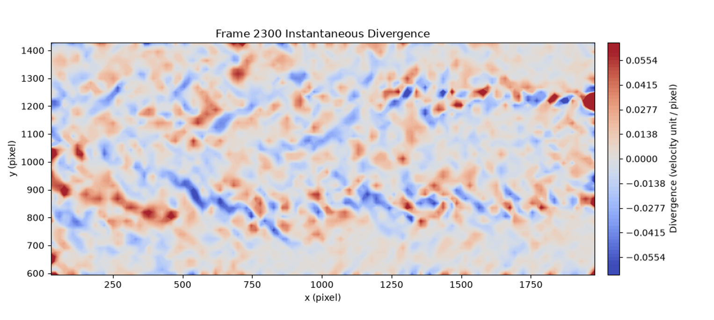
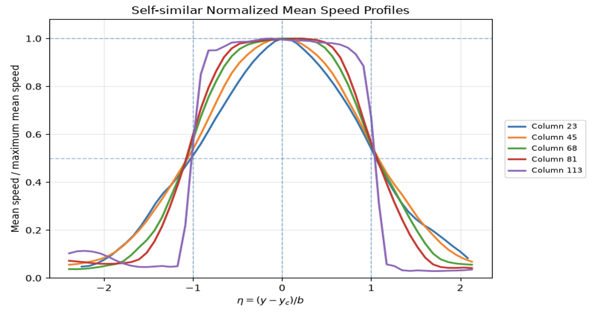

# PIV Jet Flow Analysis and Visualization

## Project Overview

This project investigates the velocity field and statistical characteristics of an experimental jet flow using Particle Image Velocimetry (PIV) data.

Conducted under faculty guidance, the project focuses on using Python to process experimental velocity measurements, identify and correct anomalous velocity vectors, visualize fluid motion, and explore physical characteristics of the flow.

The project combines experimental fluid mechanics, numerical data processing, statistical analysis, and scientific visualization.

## Dataset

The dataset consists of:

- **2,999 instantaneous PIV velocity fields**
- **53 × 123 measurement points per frame**
- Position coordinates: `x`, `y`
- Velocity components: `u`, `v`
- Original format: MATLAB `.mat`

The experimental dataset is not publicly distributed in this repository.

## Methodology

### 1. Velocity Field Visualization

Developed Python scripts to visualize instantaneous velocity fields using velocity vectors, magnitude contour plots, velocity profiles, and streamlines.

### 2. Outlier Detection and Correction

Applied statistical and local filtering methods, including the three-sigma criterion and 3 × 3 median filtering, to identify and correct anomalous velocity vectors.

Compared original and corrected results to investigate the influence of outliers on velocity field visualization and statistical calculations.

### 3. Statistical Analysis

Calculated time-averaged velocity components and velocity variances across multiple frames.

Examined statistical convergence by evaluating how estimates change as the number of sampled frames increases.

### 4. Vorticity and Divergence

Calculated two-dimensional vorticity and divergence from spatial velocity gradients:

Vorticity:

ω = ∂v/∂x − ∂u/∂y

Divergence:

∇ · V = ∂u/∂x + ∂v/∂y

These quantities were used to investigate local flow rotation and velocity-field divergence.

### 5. Velocity Profile Normalization

Compared time-averaged velocity profiles at different downstream locations.

Normalized velocity and transverse coordinates to investigate the development of the jet and assess similarities between velocity profiles.

## Selected Visualizations

### Outlier Detection and Correction

### Effect of Outlier Correction on Mean Velocity

### Statistical Convergence

### Time-Averaged Streamlines

### Vorticity Distribution

### Divergence Distribution

### Normalized Velocity Profiles

## Tools and Libraries

- Python
- NumPy
- SciPy
- Matplotlib
- MATLAB data files

## Repository Structure

- `scripts/` — Python scripts for velocity field visualization and analysis
- `figures/` — Generated figures illustrating the results
- `README.md` — Project documentation

## Limitations and Future Improvements

The analysis is based on a finite set of experimental PIV measurements and may be affected by measurement uncertainty, spatial resolution, and outlier correction methods.

Future improvements could include more systematic uncertainty quantification, sensitivity analysis of outlier-detection parameters, and further investigation of the downstream development of normalized velocity profiles.

## Acknowledgment

This project was conducted with faculty guidance at Shanghai Jiao Tong University. The computational analysis, visualizations, and documentation presented here represent my work on the assigned research tasks.
